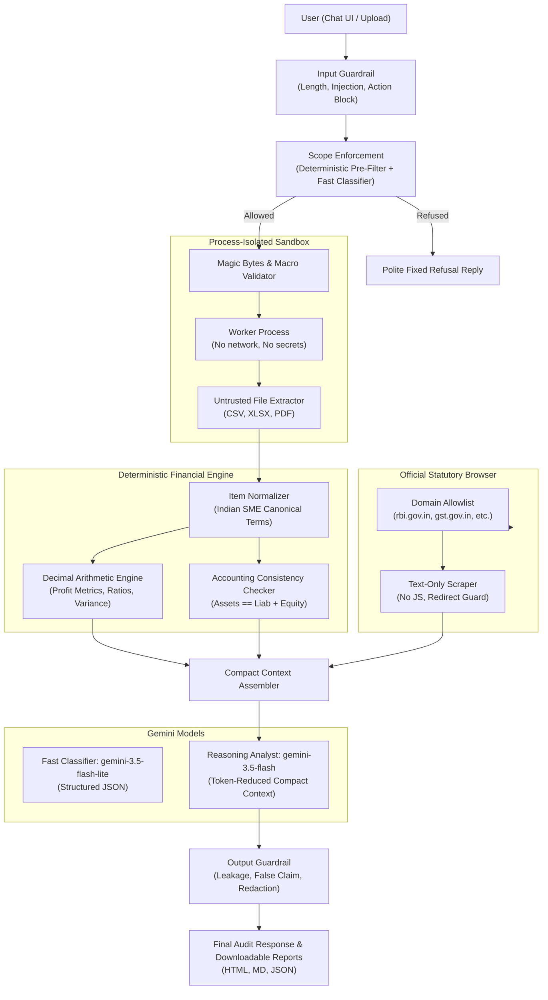

# FinanceAgent Architecture: Indian SME AI Financial Analyst

## 1. System Overview
FinanceAgent is an enterprise-grade, single specialist AI Financial Analyst purpose-built for Indian Small and Medium Enterprises (MSMEs/SMEs). It complies with Indian Accounting Standards (AS / Ind AS), Schedule III of the Companies Act 2013, and statutory regulations (Income Tax Section 43B(h), GST, and RBI working capital benchmarks).

---

## 2. Component Design

### 2.1 Process-Isolated File Parsing Sandbox
- **Isolation Mechanism**: Spawns an isolated `multiprocessing.Process` worker with dedicated pipe communication.
- **Secret Scrubbing**: Inside the child process, all environment variables matching `KEY`, `SECRET`, `TOKEN`, `AUTH`, `PASS`, or `CRED` are deleted before opening files.
- **Zero Network Access**: Child worker contains no networking libraries or socket descriptors.
- **Safety Boundaries**:
  - Size limit: 10 MB maximum upload.
  - Execution timeout: 15-second cutoff (terminates and kills unresponsive processes).
  - Magic-byte validation: Verifies `%PDF-` for PDFs, `PK\x03\x04` for XLSX, and non-binary text for CSVs.
  - Macro prohibition: Inspects ZIP contents of Excel files for `vbaProject.bin` and rejects macro-enabled spreadsheets immediately.
  - Excel formula suppression: `openpyxl.load_workbook(..., data_only=True, keep_vba=False)` ensures Excel formulas are never evaluated dynamically.
  - Cell prompt injection neutralization: Delimiters like `[INST]`, `<|im_start|>`, and `ignore previous instructions` are escaped into passive `[SANITIZED_DATA]`.

### 2.2 Two-Tier Scope Enforcement & Guardrails
- **Deterministic Pre-Filter**: Matches out-of-scope domains (medical, legal, entertainment, general coding, personal Hinglish chatter) and autonomous financial action attempts before any LLM is called.
- **Fast-Model Classifier (`gemini-3.5-flash-lite`)**: Produces structured JSON validated against Pydantic's `ClassificationResult`.
- **Fail-Closed Guarantee**: Any validation error, network timeout, rate limit, or unexpected exception automatically fails closed (`allowed: False`), routing the request to the polite fixed refusal reply.
- **Input Guardrails**:
  - Max input length: 8,000 characters.
  - Blocks prompt injection, jailbreak keywords (`DAN`, `unrestricted`), delimiter injection, and autonomous fund execution.
- **Output Guardrails**:
  - Prevents internal system prompt and secret leakage.
  - Blocks false claims of real-world completed actions ("I have transferred the money").
  - Verifies that numeric answers state currency (INR / ₹) and reporting period.
  - Active PII and credentials redactor masks PAN, Aadhaar, Phone, Email, and API keys.

### 2.3 Deterministic Decimal Arithmetic Engine
- **No LLM Math**: The Large Language Model is strictly prohibited from performing arithmetic calculations.
- **Decimal Precision**: All additions, subtractions, multiplications, divisions, percentages, and ratios are calculated using Python's `decimal.Decimal` module with `ROUND_HALF_UP` rounding.
- **Missing Value Handling**: If any financial line item or denominator is missing, the metric returns `"unavailable"`, never an ungrounded guess.
- **Canonical Normalization**: Standardizes Indian financial statement labels to:
  - *P&L*: Revenue from Operations, Cost of Materials Consumed, Employee Benefit Expenses, Finance Costs, Depreciation & Amortization, Other Expenses, PBT, Tax Expense, PAT.
  - *Balance Sheet*: Total Equity, Long-Term Borrowings, Current Liabilities, Fixed Assets, Current Assets, Total Assets.
  - *Cash Flow*: CFO, CFI, CFF, Net Change in Cash, Opening & Closing Cash.

### 2.4 Official Statutory Browser Tool
- **Allowlisted Indian Domains**:
  - `rbi.org.in` (Reserve Bank of India)
  - `incometax.gov.in` (Income Tax Department)
  - `gst.gov.in` (Goods & Services Tax Network)
  - `mca.gov.in` (Ministry of Corporate Affairs)
  - `icai.org` (Institute of Chartered Accountants of India)
  - `sebi.gov.in` (Securities and Exchange Board of India)
- **Security Features**:
  - Text-only parsing (strips scripts, styles, forms, navigation).
  - Size cap: 500 KB response limit.
  - Manual redirect inspection: Blocks redirects navigating to non-allowlisted domains.
  - Untrusted data tagging: Clearly labels fetched text as untrusted external content.

### 2.5 Token Reduction & Cost Optimization
- **Extract-Once Strategy**: Raw multi-thousand-cell spreadsheets are extracted once and stored as compact normalized data.
- **Compact Context**: The strong reasoning model (`gemini-3.5-flash`) only receives a compact JSON summary of canonical line items, computed metrics, formulas, and source references—cutting input token consumption by over 75%.
- **SHA-256 Tool Cache**: Repeated requests on the same file hash are served instantaneously from the in-memory cache without re-extracting or re-calculating.
- **Telemetry Logger**: Tracks latency, token counts, cache hits, and estimated USD/INR cost per request.

### 2.6 User Interface & API
- **FastAPI Backend**: Serves asynchronous endpoints for chat, file upload, report generation, and telemetry.
- **Interactive Single-Page UI**: Provides drag & drop file upload, real-time tool execution badges, data quality warning callouts, and downloadable audit reports (HTML, Markdown, JSON).
